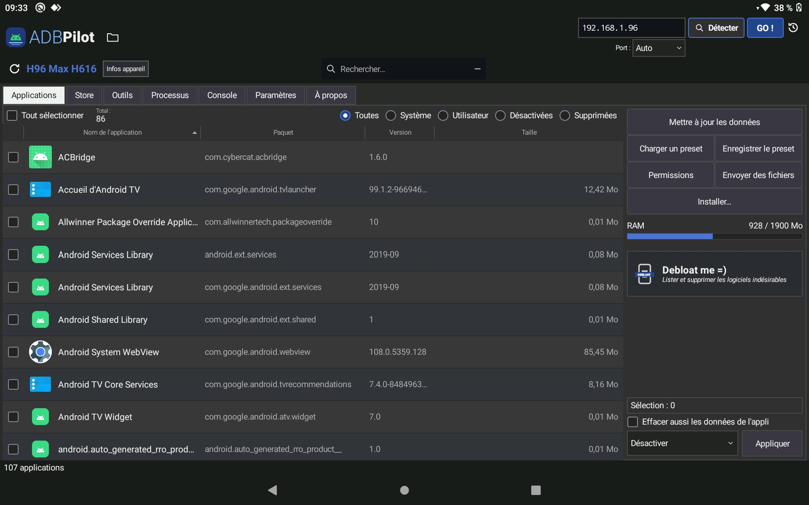
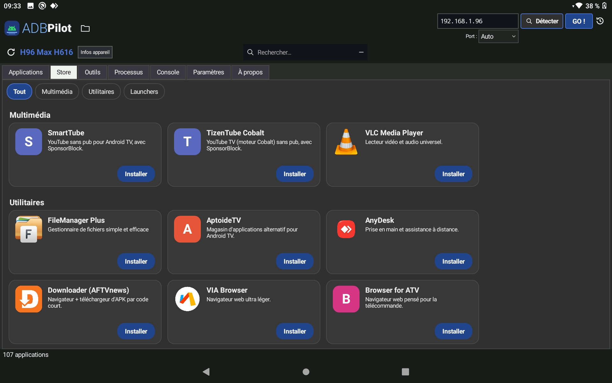
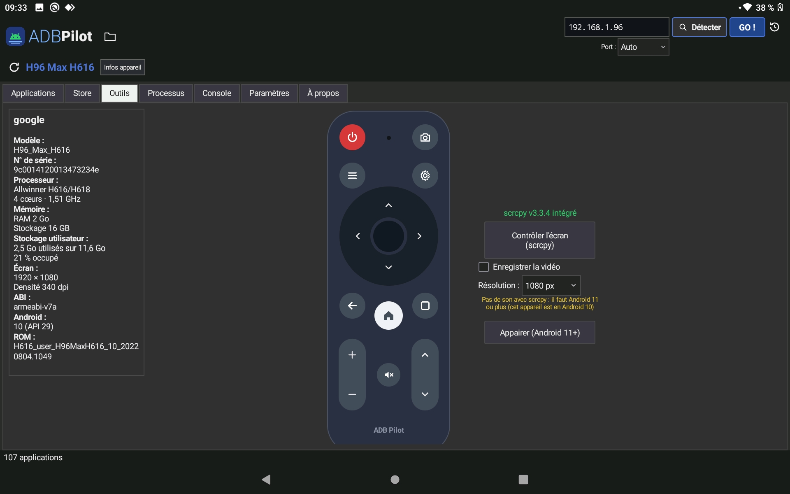
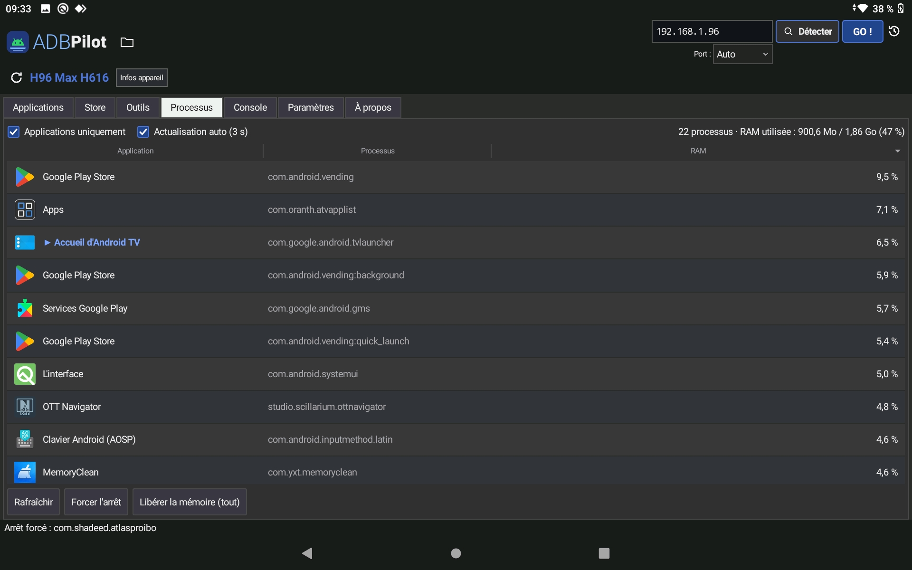
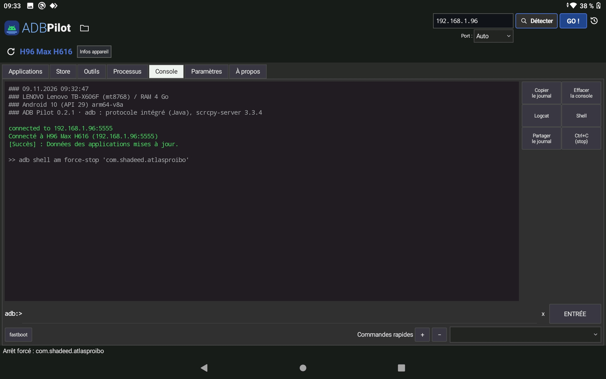

# ADB Pilot pour Android

**Gestionnaire d'appareils Android via ADB, depuis une tablette Android — sans PC, sans root.**

ADB Pilot pour Android permet de gérer une box Android TV ou un téléphone depuis une tablette, en **Wi-Fi** ou en **USB OTG** :
- lister les applications avec leurs noms, icônes et versions ;
- désactiver ou désinstaller le bloatware ;
- installer des APK / XAPK / APKS / APKM ;
- sauvegarder des applications ;
- suivre les processus ;
- piloter l'écran avec scrcpy ;
- ouvrir une console adb / fastboot.

C'est la version tablette d'**[ADB Pilot](https://github.com/rerem8433/adb_pilot)** (Linux, Windows, macOS), avec la même interface.

Développé par **ParadoxXx Squad** — [github.com/rerem8433/adb_pilot_android](https://github.com/rerem8433/adb_pilot_android)

> 🧪 **Version de test** : merci de signaler tout problème dans les [Issues](https://github.com/rerem8433/adb_pilot_android/issues).


## Pourquoi ce projet ?

ADB Pilot est né sur PC, comme alternative native à **[ADB AppControl](https://adbappcontrol.com)** (de *Cyber.Cat*). Pour programmer des box chez un client ou sur le canapé, une tablette est bien plus pratique qu'un ordinateur portable.

Cette version n'est **pas un portage** de l'application PC : elle est **réécrite en Java natif Android**, avec son propre protocole ADB. Elle reprend la même logique (détection du SoC, de la vraie RAM et de la vraie version d'Android, listes debloat, catalogue du Store) et la même interface. Elle a été conçue avec l'aide de **Claude**, l'assistant IA d'Anthropic, puis testée et ajustée sur mon propre parc de box.

> ADB Pilot est un projet indépendant, **sans lien** avec ADB AppControl ni avec son auteur.

## Fonctionnalités

- **Connexion sans PC** : ADB est intégré à l'application (aucun binaire adb, aucun serveur adb).
  - En **Wi-Fi** (port 5555) ou en **USB OTG** (câble USB-C / micro-USB vers USB-A).
  - Clé RSA propre à la tablette, acceptée une fois sur l'écran de la box (« Toujours autoriser »).
- **Détecter** : scan du réseau local. Il trouve les appareils dont le port ADB est ouvert et affiche leur nom grâce à la bannière ADB, au mDNS (Google Cast, Android TV), à l'historique ou au DNS.
- **Applications** :
  - noms, icônes et versions lus **sur l'appareil lui-même** (icônes adaptatives et traductions comprises) ;
  - filtres *Toutes / Système / Utilisateur / Désactivées / Supprimées* et recherche ;
  - actions : désactiver, activer, désinstaller (utilisateur 0), restaurer, forcer l'arrêt, effacer les données ou le cache, sauvegarder le fichier d'installation (`.apk`, ou `.apks` pour les applis en plusieurs fichiers) ;
  - fiche détaillée, gestion des permissions, presets de sélection ;
  - colonnes triables et redimensionnables au doigt.
- **Debloat me =)** : assistant en 4 niveaux (*Basique, Sûr, Moyen, Maximal*). Les composants vitaux des téléphones sont protégés automatiquement.
- **Installer** : bibliothèque d'APK / XAPK / APKS / APKM (avec copie des OBB).
  - Dossier commun ou dossier par appareil.
  - État de chaque fichier : non installée, installée, mise à jour disponible…
  - Installation rapide de toute la sélection.
  - Les APK partagés depuis une autre appli (navigateur, gestionnaire de fichiers…) y sont ajoutés.
- **Store** : installation en un clic (SmartTube, VLC, Projectivy…) depuis le catalogue maintenu sur GitHub.
- **Outils** :
  - fiche de l'appareil : processeur, RAM et stockage **réels**, écran, vraie version d'Android (lue dans le framework, pas dans `build.prop`). Les ROM truquées sont signalées ;
  - télécommande Android TV, menu alimentation (redémarrage recovery / bootloader / fastboot) ;
  - captures d'écran ;
  - passage de l'USB au Wi-Fi.
- **scrcpy intégré** (serveur v3.3.4) :
  - affichage et contrôle de l'écran avec le décodage matériel de la tablette ;
  - tactile multipoint, clavier, boutons Retour / Accueil / Récents / volume / Power ;
  - son pour les appareils en Android 11 ou plus ;
  - enregistrement en MP4.
- **Processus** : applications en cours, RAM en %, application au premier plan, forcer l'arrêt, libérer la mémoire.
- **Console** :
  - commandes adb (`shell`, `install`, `push`, `pull`, `reboot`, `tcpip`…) et fastboot en USB (`getvar`, `flash`, `erase`, `oem`, `flashing`…) ;
  - shell interactif, logcat, commandes rapides enregistrées.
- **Mises à jour** : l'application vérifie ce dépôt au démarrage, puis télécharge et installe la nouvelle version par-dessus en un clic.

## Captures d'écran

**Applications** : liste avec noms, icônes, versions et tailles, panneau d'actions et assistant debloat.



**Store** : installation en un clic.



**Outils** : fiche de l'appareil, télécommande et scrcpy.



**scrcpy** : l'écran de la box sur la tablette.


**Processus** : applications en cours et RAM.



**Console** : adb / fastboot, shell, logcat.



## Compatibilité

**Tablette (où s'installe ADB Pilot)**

| Système | Statut |
|---|---|
| Android 5.0 et plus récent, tablette 8" / 10" (paysage) | 🧪 Test — validé sur Lenovo Tab M10 FHD (Android 11) |
| Téléphone | ⚠️ Fonctionne, mais l'interface est pensée pour un écran de tablette |
| USB OTG | ✅ Si la tablette gère l'USB hôte (câble OTG) |

**Appareils pilotés** : toute box Android TV, téléphone ou tablette avec le débogage ADB activé (Amlogic, Rockchip, Allwinner, MediaTek, Qualcomm…). Pour le son dans scrcpy, l'appareil doit être en Android 11 ou plus.

## Installation

1. Télécharge le dernier `ADB-Pilot-X.Y.Z-android.apk` dans les [Releases](https://github.com/rerem8433/adb_pilot_android/releases).
2. Ouvre-le sur la tablette et autorise l'installation d'applications inconnues si Android le demande.
3. Au premier lancement, accepte l'accès au stockage : tes fichiers vont dans `/sdcard/ADB_Pilot`.

Les versions suivantes se proposent toutes seules au démarrage d'ADB Pilot.

## Premiers pas

**En Wi-Fi**
1. Sur la box : *Options pour les développeurs* → *Débogage ADB* (et *ADB par réseau* / *Débogage réseau* selon la ROM).
2. Dans ADB Pilot : touche **Détecter**, choisis la box, ou saisis son IP et touche **GO !**.
3. Sur l'écran de la box : accepte « Autoriser le débogage ? » en cochant **Toujours autoriser depuis cet ordinateur**.

**En USB OTG**
1. Branche la box ou le téléphone sur la tablette avec un câble OTG, sur le port USB de débogage de la box.
2. Accepte l'accès USB demandé par Android, puis la demande de débogage sur l'appareil.
3. Touche **Passer en Wi-Fi** pour continuer sans câble.

> Le *débogage sans fil* d'Android 11+ (appairage par code) n'est pas encore pris en charge : utilise le port 5555.

## Dossiers

Tout est centralisé dans `/sdcard/ADB_Pilot/` :

| Dossier | Contenu |
|---|---|
| `images/` | Captures d'écran |
| `videos/` | Enregistrements scrcpy |
| `install/` | Ta bibliothèque d'APK à installer (+ un sous-dossier par appareil) |
| `apps/<appareil>/` | Sauvegardes : `nomappli_(paquet)_version.apk` (`.apks` pour les applis en plusieurs fichiers) |
| `store/` | APK téléchargés depuis l'onglet Store |
| `presets/` | Presets de sélection (applications et installation) |

## Listes de debloat

Les listes `debloat0.db` à `debloat3.db` sont celles du dépôt [ADB Pilot](https://github.com/rerem8433/adb_pilot/tree/main/debloat). Elles sont mises à jour automatiquement au lancement, et une copie est intégrée pour fonctionner hors ligne.

Les niveaux sont **cumulatifs** :

| Niveau | Fichiers utilisés |
|---|---|
| Basique | `debloat0.db` |
| Sûr | `debloat0.db` + `debloat1.db` |
| Moyen | `debloat0.db` à `debloat2.db` |
| Maximal | `debloat0.db` à `debloat3.db` |

L'assistant ne fait que **cocher** les applications concernées. Rien n'est désactivé avant que tu touches *Appliquer*.

## Compiler depuis les sources

Sans Gradle ni Android Studio. Testé sous Ubuntu 24.04 :

```bash
sudo apt install openjdk-21-jdk-headless aapt dalvik-exchange apksigner zipalign
mkdir -p ../sdk && curl -L -o ../sdk/android-30.jar \
  https://raw.githubusercontent.com/Sable/android-platforms/master/android-30/android.jar
./build.sh            # -> build/ADB-Pilot-<version>-android.apk
```

Adapte `SDK=` (android.jar) et `KS=` (keystore de signature, absent du dépôt) en tête de `build.sh`.

- `src/` : l'application (protocole ADB, interface, scrcpy).
- `helper/` : petit programme exécuté **sur l'appareil piloté** (`app_process`) pour lire noms, icônes, versions et la vraie version d'Android. `build.sh` le compile en `assets/helper.jar`.
- `tools/mkicons.py` : regénère les icônes depuis les SVG de la version PC.

## ⚠️ Avertissement

Désactiver ou désinstaller des applications système peut provoquer des dysfonctionnements : perte du clavier de la télécommande, de la mise à jour OTA, du Play Store… Vérifie toujours la liste avant d'appliquer. Une application supprimée pour l'utilisateur 0 peut être restaurée depuis le filtre *Supprimées* → appui long → *Restaurer (réinstaller)*. Tu utilises ce logiciel à tes propres risques.

## Mentions et crédits

- **Inspiration** : [ADB AppControl](https://adbappcontrol.com) par *Cyber.Cat*, pour l'ergonomie et le principe. Aucun code ni ressource repris.
- **Développement** : ParadoxXx Squad, avec l'aide de **Claude** (Anthropic).
- **[scrcpy](https://github.com/Genymobile/scrcpy)** — Genymobile, licence **Apache-2.0**. Le serveur `scrcpy-server` v3.3.4 est embarqué, sans modification.
- **[Universal Android Debloater Next Generation (UAD-ng)](https://github.com/Universal-Debloater-Alliance/universal-android-debloater-next-generation)** — licence **GPL-3.0**. Descriptions de paquets affichées dans les infos.
- Protocole ADB réimplémenté d'après la documentation de l'Android Open Source Project (Apache-2.0).
- *Android* est une marque de Google LLC. Les autres noms cités appartiennent à leurs propriétaires respectifs.

## Licence

ADB Pilot pour Android est distribué sous licence **GNU General Public License v3.0**. Voir le fichier [LICENSE](LICENSE).

Copyright © 2026 ParadoxXx Squad

---
---

# ADB Pilot for Android — English

**Android device manager over ADB, from an Android tablet — no PC, no root.**

ADB Pilot for Android lets you manage an Android TV box or a phone from a tablet, over **Wi-Fi** or **USB OTG**:
- list apps with their names, icons and versions;
- disable or uninstall bloatware;
- install APK / XAPK / APKS / APKM files;
- back up apps;
- monitor processes;
- control the screen with scrcpy;
- open an adb / fastboot console.

It is the tablet edition of **[ADB Pilot](https://github.com/rerem8433/adb_pilot)** (Linux, Windows, macOS), with the same interface.

Developed by **ParadoxXx Squad** — [github.com/rerem8433/adb_pilot_android](https://github.com/rerem8433/adb_pilot_android)

> 🧪 **Test build**: please report any issue in [Issues](https://github.com/rerem8433/adb_pilot_android/issues).

## Why this project?

ADB Pilot started on PC as a native alternative to **[ADB AppControl](https://adbappcontrol.com)** (by *Cyber.Cat*). To set up boxes at a customer's place or from the couch, a tablet is far handier than a laptop.

This edition is **not a port** of the PC app: it is **rewritten in native Android Java**, with its own ADB protocol implementation. It keeps the same logic (SoC detection, real RAM and real Android version, debloat lists, Store catalog) and the same interface. It was designed with the help of **Claude**, Anthropic's AI assistant, then tested and tuned on my own boxes.

> ADB Pilot is an independent project, **not affiliated** with ADB AppControl or its author.

## Features

- **No PC needed**: ADB is built into the app (no adb binary, no adb server).
  - Over **Wi-Fi** (port 5555) or **USB OTG** (USB-C / micro-USB to USB-A cable).
  - Tablet-specific RSA key, accepted once on the box screen ("Always allow").
- **Detect**: local network scan. It finds devices with an open ADB port and shows their name from the ADB banner, mDNS (Google Cast, Android TV), history or DNS.
- **Apps**:
  - names, icons and versions read **on the device itself** (adaptive icons and translations included);
  - *All / System / User / Disabled / Removed* filters and search;
  - actions: disable, enable, uninstall (user 0), restore, force stop, clear data or cache, back up the install file (`.apk`, or `.apks` for multi-file apps);
  - detail sheet, permission management, selection presets;
  - sortable columns, resizable by touch.
- **Debloat me =)**: 4-level wizard (*Basic, Safe, Medium, Maximal*). Vital phone components are protected automatically.
- **Installer**: APK / XAPK / APKS / APKM library (OBB files copied).
  - Shared folder or one folder per device.
  - Status of each file: not installed, installed, update available…
  - Quick install of the whole selection.
  - APKs shared from another app (browser, file manager…) are added to it.
- **Store**: one-click install (SmartTube, VLC, Projectivy…) from the catalog maintained on GitHub.
- **Tools**:
  - device sheet: **real** CPU, RAM and storage, screen, real Android version (read from the framework, not `build.prop`). Fake ROMs are flagged;
  - Android TV remote, power menu (reboot to recovery / bootloader / fastboot);
  - screenshots;
  - USB to Wi-Fi switch.
- **Built-in scrcpy** (server v3.3.4):
  - screen mirroring and control with the tablet's hardware decoder;
  - multi-touch, keyboard, Back / Home / Recents / volume / Power buttons;
  - audio for devices on Android 11 or later;
  - MP4 recording.
- **Processes**: running apps, RAM in %, foreground app, force stop, free memory.
- **Console**:
  - adb commands (`shell`, `install`, `push`, `pull`, `reboot`, `tcpip`…) and fastboot over USB (`getvar`, `flash`, `erase`, `oem`, `flashing`…);
  - interactive shell, logcat, saved quick commands.
- **Updates**: the app checks this repository at startup, then downloads and installs the new version over the current one in one tap.

## Screenshots

See the [French section](#captures-décran) above.

## Compatibility

**Tablet (where ADB Pilot is installed)**

| System | Status |
|---|---|
| Android 5.0 or newer, 8" / 10" tablet (landscape) | 🧪 Test — validated on Lenovo Tab M10 FHD (Android 11) |
| Phone | ⚠️ Works, but the UI is designed for a tablet screen |
| USB OTG | ✅ If the tablet supports USB host (OTG cable) |

**Managed devices**: any Android TV box, phone or tablet with ADB debugging enabled (Amlogic, Rockchip, Allwinner, MediaTek, Qualcomm…). For audio in scrcpy, the device must run Android 11 or later.

## Installation

1. Download the latest `ADB-Pilot-X.Y.Z-android.apk` from [Releases](https://github.com/rerem8433/adb_pilot_android/releases).
2. Open it on the tablet and allow installing unknown apps if Android asks.
3. On first launch, allow storage access: your files go to `/sdcard/ADB_Pilot`.

Later versions are offered automatically when ADB Pilot starts.

## Getting started

**Over Wi-Fi**
1. On the box: *Developer options* → *ADB debugging* (and *ADB over network* / *Network debugging* depending on the ROM).
2. In ADB Pilot: tap **Detect** and pick the box, or type its IP and tap **GO !**.
3. On the box screen: accept "Allow USB debugging?" and tick **Always allow from this computer**.

**Over USB OTG**
1. Plug the box or phone into the tablet with an OTG cable, on the box's debugging USB port.
2. Accept the USB access asked by Android, then the debugging prompt on the device.
3. Tap **Switch to Wi-Fi** to go cable-free.

> Android 11+ *wireless debugging* (pairing code) is not supported yet: use port 5555.

## Folders

Everything lives in `/sdcard/ADB_Pilot/`:

| Folder | Content |
|---|---|
| `images/` | Screenshots |
| `videos/` | scrcpy recordings |
| `install/` | Your APK library (+ one subfolder per device) |
| `apps/<device>/` | Backups: `appname_(package)_version.apk` (`.apks` for multi-file apps) |
| `store/` | APKs downloaded from the Store tab |
| `presets/` | Selection presets (apps and install) |

## Debloat lists

The `debloat0.db` to `debloat3.db` lists come from the [ADB Pilot](https://github.com/rerem8433/adb_pilot/tree/main/debloat) repository. They are updated automatically at startup, and a copy is built in to work offline.

Levels are **cumulative**:

| Level | Files used |
|---|---|
| Basic | `debloat0.db` |
| Safe | `debloat0.db` + `debloat1.db` |
| Medium | `debloat0.db` to `debloat2.db` |
| Maximal | `debloat0.db` to `debloat3.db` |

The wizard only **ticks** the matching apps. Nothing is disabled until you tap *Apply*.

## Build from source

No Gradle or Android Studio needed. Tested on Ubuntu 24.04:

```bash
sudo apt install openjdk-21-jdk-headless aapt dalvik-exchange apksigner zipalign
mkdir -p ../sdk && curl -L -o ../sdk/android-30.jar \
  https://raw.githubusercontent.com/Sable/android-platforms/master/android-30/android.jar
./build.sh            # -> build/ADB-Pilot-<version>-android.apk
```

Set `SDK=` (android.jar) and `KS=` (signing keystore, not in the repository) at the top of `build.sh`.

- `src/`: the app (ADB protocol, UI, scrcpy).
- `helper/`: small program run **on the managed device** (`app_process`) to read names, icons, versions and the real Android version. `build.sh` compiles it into `assets/helper.jar`.
- `tools/mkicons.py`: regenerates the icons from the PC edition's SVGs.

## ⚠️ Disclaimer

Disabling or uninstalling system apps can break things: remote keyboard, OTA updates, Play Store… Always review the list before applying. An app removed for user 0 can be restored from the *Removed* filter → long press → *Restore (reinstall)*. Use this software at your own risk.

## Credits

- **Inspiration**: [ADB AppControl](https://adbappcontrol.com) by *Cyber.Cat*, for the ergonomics and concept. No code or resources reused.
- **Development**: ParadoxXx Squad, with the help of **Claude** (Anthropic).
- **[scrcpy](https://github.com/Genymobile/scrcpy)** — Genymobile, **Apache-2.0** license. The `scrcpy-server` v3.3.4 is bundled unmodified.
- **[Universal Android Debloater Next Generation (UAD-ng)](https://github.com/Universal-Debloater-Alliance/universal-android-debloater-next-generation)** — **GPL-3.0** license. Package descriptions shown in app details.
- ADB protocol reimplemented from the Android Open Source Project documentation (Apache-2.0).
- *Android* is a trademark of Google LLC. Other names belong to their respective owners.

## License

ADB Pilot for Android is released under the **GNU General Public License v3.0**. See [LICENSE](LICENSE).

Copyright © 2026 ParadoxXx Squad
